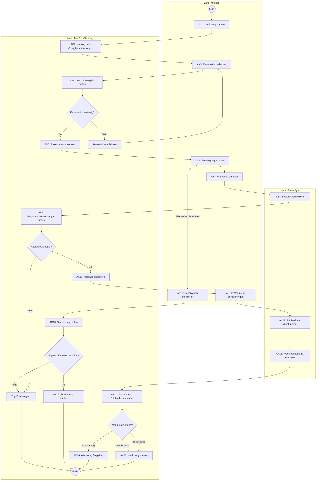
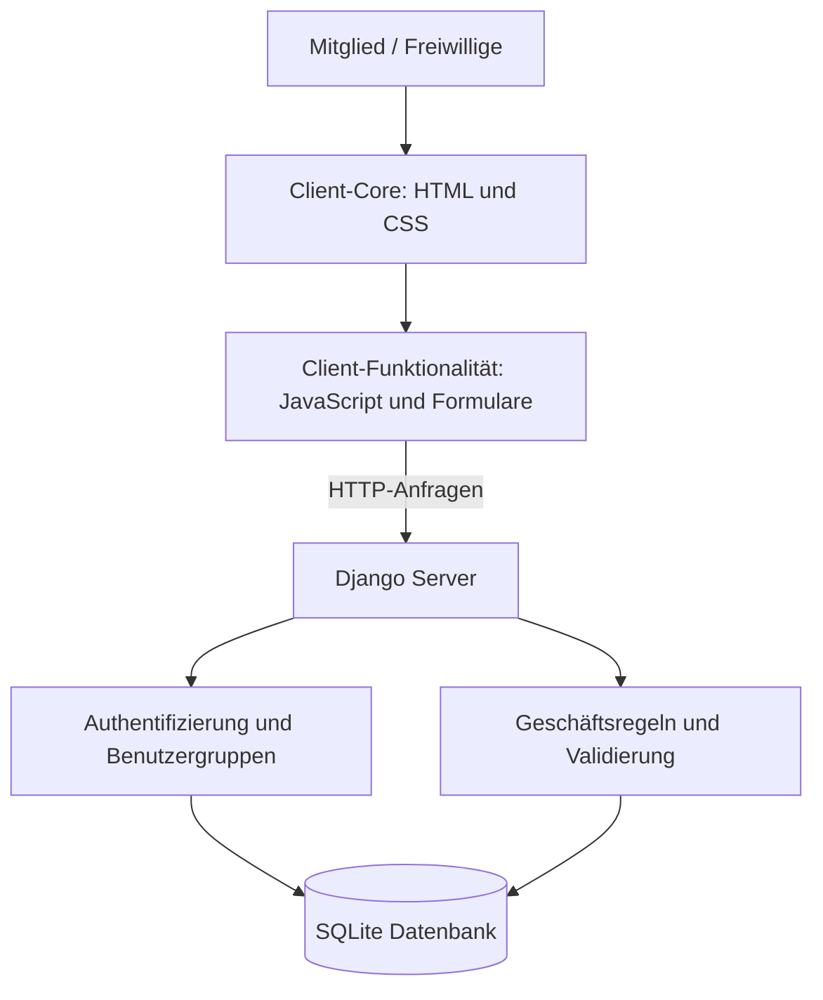

# Teil A – Analyse nach Modell

## ToolBox – Werkzeugausleihe eines Quartiervereins

**Projekt:** Toolbox_teko
**Modul:** Web Engineering
**Version:** 1.0
**Bearbeitungszeit:** 60 Minuten

---

## 1. Ausgangslage

Der Quartierverein Lindenhof betreibt eine Werkzeugbibliothek
mit rund 120 Werkzeugen, 80 Mitgliedern und einem Team von
Freiwilligen.

Die bisherige Verwaltung über eine Excel-Liste führt zu
Doppelbuchungen, unberechtigten Änderungen und einem erhöhten
Verwaltungsaufwand.

Mit der Web-Applikation ToolBox soll die Werkzeugausleihe
digitalisiert und vereinfacht werden.

### Ziele

- Werkzeuge online suchen und reservieren.
- Doppelbuchungen verhindern.
- Ausleihregeln automatisch überprüfen.
- Ausgabe und Rücknahme digital verwalten.
- Beschädigte Werkzeuge sperren.
- Personenbezogene Daten schützen.
- Eine einfache und mobilfreundliche Bedienung ermöglichen.

### Technischer Rahmen

- Backend: Python mit Django
- Datenbank: SQLite
- Frontend: HTML, CSS und JavaScript
- Authentifizierung: Django Authentication
- Versionsverwaltung: Git und GitHub
- Benutzergruppen: Mitglied und Freiwillige

---

## A1 – Geschäftsprozess als BPMN

### Beteiligte Rollen

| Rolle | Verantwortung |
|---|---|
| Mitglied | Werkzeuge suchen, reservieren, abholen, zurückbringen und eigene Reservationen stornieren |
| ToolBox (System) | Verfügbarkeit, Geschäftsregeln, Berechtigungen und Werkzeugstatus überprüfen |
| Freiwillige | Ausgabe, Rücknahme, Einführung, Kaution und Werkzeugzustand verwalten |

### Prozessdiagramm



### Geschäftsregeln

- Eine Ausleihe dauert maximal sieben Tage (Z2).
- Ein Mitglied darf gleichzeitig maximal drei Werkzeuge
  ausleihen (Z2).
- Ausgabe und Rücknahme erfolgen samstags von 09:00 bis
  12:00 Uhr (Z3).
- Zeitlich überlappende Reservationen desselben Werkzeugs
  sind nicht erlaubt (Z4).
- Elektrowerkzeuge dürfen nur mit dokumentierter Einführung
  ausgeliehen werden (Z7).
- Für Elektrowerkzeuge muss eine Kaution von CHF 50
  hinterlegt werden (Z8).
- Beschädigte Werkzeuge werden bis zur Reparatur gesperrt
  (Z6).
- Mitglieder dürfen ausschliesslich eigene offene
  Reservationen stornieren (Z10, Z12).

---

## A2 – Funktionale Anforderungen

Die funktionalen Anforderungen werden aus den
Interviewnotizen und den Systemaktivitäten abgeleitet.

MVP steht für Minimum Viable Product und bezeichnet
die erste funktionsfähige Version der Anwendung.

| Anf-ID | Aktivität | Prüfbare Anforderung | Quelle | Im MVP? / Begründung |
|---|---|---|---|---|
| F01 | AK2 | Das System zeigt den Werkzeugkatalog inklusive Verfügbarkeit für einen ausgewählten Zeitraum an. | Z1 | Ja – Grundfunktion |
| F02 | AK4 | Das System verhindert zeitlich überlappende Reservationen desselben Werkzeugs. | Z4 | Ja – verhindert Doppelbuchungen |
| F03 | AK4 | Das System lehnt Reservationen mit einer Dauer von mehr als sieben Tagen ab. | Z2 | Ja – verbindliche Geschäftsregel |
| F04 | AK4 | Das System verhindert, dass ein Mitglied gleichzeitig mehr als drei Werkzeuge reserviert oder ausgeliehen hat. | Z2 | Ja – gerechte Verteilung |
| F05 | AK4, AK9, AK14 | Das System akzeptiert reguläre Abhol- und Rückgabetermine nur samstags zwischen 09:00 und 12:00 Uhr. | Z3 | Ja – Depotöffnungszeiten |
| F06 | AK4, AK9 | Das System verhindert die Reservation und Ausgabe eines Elektrowerkzeugs ohne dokumentierte Einführung. | Z7 | Ja – Unfallprävention |
| F07 | AK9 | Das System verhindert die Ausgabe eines Elektrowerkzeugs, solange die Kaution von CHF 50 nicht als bezahlt erfasst wurde. | Z8 | Ja – finanzielle Absicherung |
| F08 | AK18, AK19 | Das System erlaubt Mitgliedern nur die Stornierung ihrer eigenen offenen Reservationen. | Z10, Z12 | Ja – Schutz vor Manipulation |
| F09 | AK9, AK10 | Nur authentifizierte Benutzer der Gruppe Freiwillige dürfen eine Werkzeugausgabe bestätigen. | Z5 | Ja – Zugriffsschutz |
| F10 | AK14 | Nur Freiwillige dürfen eine Rücknahme speichern. Dabei muss einer der drei Zustände in Ordnung, beschädigt oder unvollständig ausgewählt werden. | Z5, Z6 | Ja – Zustandskontrolle |
| F11 | AK15 | Das System sperrt beschädigte Werkzeuge automatisch für weitere Reservationen und Ausgaben. | Z6 | Ja – Sicherheitsanforderung |
| F12 | AK16 | Ein ordnungsgemäss zurückgegebenes Werkzeug wird unter Berücksichtigung weiterer Reservationen wieder als verfügbar angezeigt. | Z1, Z6 | Ja – korrekte Verfügbarkeit |
| F13 | AK2, AK9 | Die Telefonnummer eines Mitglieds darf ausschliesslich von berechtigten Freiwilligen und vom betreffenden Mitglied eingesehen werden. | Z9 | Ja – Datenschutz |
| F14 | AK2 | Der Werkzeugkatalog ist bei einer Bildschirmbreite von 375 Pixeln ohne horizontales Scrollen bedienbar. | Z5, Z14 | Ja – mobile Bedienung |
| F15 | AK4 | Das System sperrt Mitglieder nach zwei verspäteten Rückgaben für sechs Monate. | Z11 | Nein – spätere Erweiterung |
| F16 | AK5 | Das System versendet vor dem Rückgabetermin eine Erinnerungs-E-Mail. | Z13 | Nein – geringe Priorität |
| F17 | AK5 | Nur authentifizierte Mitglieder dürfen eine Reservation für sich selbst erstellen. Die Benutzerzuordnung erfolgt serverseitig. | Z1, Z10 | Ja – Zugriffsschutz |
| F18 | AK9 | Nur Freiwillige dürfen eine Einführung oder eine bezahlte Kaution dokumentieren. | Z7, Z8 | Ja – verhindert Manipulation |

### MVP-Abgrenzung

In der ersten Version werden der Werkzeugkatalog,
das Reservationssystem, die Geschäftsregeln,
die Benutzerverwaltung sowie die Ausgabe und Rücknahme
umgesetzt.

Die automatische Sperrung nach verspäteten Rückgaben
und die E-Mail-Erinnerungen werden auf eine spätere
Version verschoben.

Verspätete Rückgaben müssen trotzdem gespeichert werden
können, damit tatsächlich zurückgebrachte Werkzeuge
nicht dauerhaft als ausgeliehen gelten.

---

## A3 – Risikoanalyse

### Bewertungsmethode

Das funktionale Risiko berechnet sich aus:

Funktionales Risiko = ETW × Ausmass

ETW = Eintretenswahrscheinlichkeit

### Bewertungsskala

| Wert | Eintretenswahrscheinlichkeit | Ausmass |
|---|---|---|
| 1 | Sehr unwahrscheinlich | Unbedeutend |
| 2 | Unwahrscheinlich | Gering |
| 3 | Möglich | Mittel |
| 4 | Wahrscheinlich | Hoch |
| 5 | Sehr wahrscheinlich | Kritisch |

Das Sicherheitsrisiko wird separat auf einer Skala
von 1 bis 5 bewertet.

| Wert | Sicherheitsrisiko |
|---|---|
| 1 | Sehr gering |
| 2 | Gering |
| 3 | Mittel |
| 4 | Hoch |
| 5 | Kritisch |

### Risikobewertung

| Anf-ID | ETW | Ausmass | Funkt. Risiko | Konkrete Bedrohung | Sich.-Risiko |
|---|---:|---:|---:|---|---:|
| F01 | 4 | 3 | 12 | Ein Mitglied manipuliert Suchparameter und versucht, nicht öffentliche Werkzeugdaten abzurufen. | 2 |
| F02 | 5 | 5 | 25 | Ein Mitglied sendet mehrere gleichzeitige Reservationsanfragen für dasselbe Werkzeug. | 5 |
| F03 | 3 | 3 | 9 | Ein Mitglied verändert das Rückgabedatum in einer direkten HTTP-Anfrage. | 3 |
| F04 | 4 | 4 | 16 | Ein Mitglied umgeht das Ausleihlimit durch parallele Reservationsanfragen. | 4 |
| F05 | 3 | 3 | 9 | Ein Mitglied sendet absichtlich einen Termin ausserhalb der Depotöffnungszeiten. | 3 |
| F06 | 3 | 5 | 15 | Ein Mitglied versucht, ohne Einführung ein gefährliches Elektrowerkzeug auszuleihen. | 5 |
| F07 | 3 | 4 | 12 | Ein Mitglied versucht, den Kautionsstatus über manipulierte Formulardaten zu ändern. | 4 |
| F08 | 4 | 5 | 20 | Ein Mitglied verändert die Reservations-ID in einer Anfrage und versucht, eine fremde Reservation zu stornieren. | 5 |
| F09 | 3 | 4 | 12 | Ein Mitglied ruft die geschützte Ausgabefunktion direkt auf. | 5 |
| F10 | 3 | 4 | 12 | Ein Mitglied versucht, eine nicht erfolgte Rückgabe als abgeschlossen zu speichern. | 4 |
| F11 | 4 | 5 | 20 | Ein Mitglied versucht, ein gesperrtes Werkzeug durch eine direkte Anfrage zu reservieren. | 5 |
| F12 | 3 | 3 | 9 | Ein Benutzer versucht, durch manipulierte Rückgabedaten die Verfügbarkeit zu verändern. | 2 |
| F13 | 4 | 4 | 16 | Ein Mitglied versucht, über direkte Benutzer-IDs fremde Telefonnummern abzurufen. | 5 |
| F14 | 4 | 2 | 8 | Eine unübersichtliche Darstellung begünstigt versehentliche Fehlbedienungen. | 1 |
| F15 | 2 | 3 | 6 | Ein Mitglied mit wiederholt verspäteten Rückgaben reserviert weiterhin Werkzeuge. | 3 |
| F16 | 2 | 2 | 4 | Ein Benutzer versucht bei einer späteren Umsetzung, durch wiederholte Anfragen unerwünschte E-Mails auszulösen. | 1 |
| F17 | 4 | 4 | 16 | Ein Angreifer versucht ohne Anmeldung oder mit einer fremden Benutzer-ID zu reservieren. | 5 |
| F18 | 3 | 5 | 15 | Ein Mitglied versucht, seine Einführung oder Kaution selbst als bestätigt zu speichern. | 5 |

### Wichtigste Risiken

Besonders kritisch sind:

- Doppelbuchungen (F02)
- Umgehung des Ausleihlimits (F04)
- Elektrowerkzeuge ohne Einführung (F06)
- Stornierung fremder Reservationen (F08)
- Ausleihe beschädigter Werkzeuge (F11)
- Offenlegung personenbezogener Daten (F13)
- Unberechtigte Reservationen (F17)
- Manipulation von Einführung und Kaution (F18)

Diese Risiken können zu Unfällen, Datenschutzverletzungen,
finanziellen Schäden und Vertrauensverlust führen.

---

## A4 – Risiko-Portfolio

### Definition der Quadranten

X-Achse: Funktionales Risiko (1–25)

Y-Achse: Sicherheitsrisiko (1–5)

Für dieses Projekt werden folgende Grenzen festgelegt:

- Funktionales Risiko niedrig: 1–12
- Funktionales Risiko hoch: 13–25
- Sicherheitsrisiko niedrig: 1–3
- Sicherheitsrisiko hoch: 4–5

### Risiko-Portfolio

| Sicherheitsrisiko | Funktionales Risiko niedrig (1–12) | Funktionales Risiko hoch (13–25) |
|---|---|---|
| Hoch (4–5) | Q2: F07, F09, F10 | Q1: F02, F04, F06, F08, F11, F13, F17, F18 |
| Niedrig (1–3) | Q3: F01, F03, F05, F12, F14, F15, F16 | Q4: Keine Anforderungen |

### Grafische Darstellung

```text
Sicherheitsrisiko
  5 |
    | Q2              | Q1
    | F09             | F02 F06 F08 F11
  4 | F07 F10         | F04 F13 F17 F18
    |-----------------+-------------------
  3 | F03 F05 F15     |
    |                 |
  2 | F01 F12         |
    |                 |
  1 | F14 F16         |
    | Q3              | Q4
    +-----------------+------------------->
    1                12/13              25
                     Funktionales Risiko
```

Die tabellarische Zuordnung ist für die exakten
Risikowerte massgebend.

### Bedeutung der Quadranten

#### Q1 – Kritische Risiken

Hohes funktionales Risiko und hohes Sicherheitsrisiko.

Diese Anforderungen werden prioritär serverseitig umgesetzt
und jeweils mit mindestens einem positiven und einem
negativen Test oder Grenzwerttest überprüft.

#### Q2 – Sicherheitskritische Risiken

Niedriges funktionales Risiko und hohes Sicherheitsrisiko.

Der Schwerpunkt liegt auf Berechtigungsprüfungen,
Zugriffsschutz und gezielten Manipulationstests.

#### Q3 – Geringe Risiken

Niedriges funktionales Risiko und niedriges Sicherheitsrisiko.

Die Anforderungen werden mit normalen Funktions- und
Bedienungstests überprüft oder begründet zurückgestellt.

#### Q4 – Funktional kritische Risiken

Hohes funktionales Risiko und niedriges Sicherheitsrisiko.

Der Schwerpunkt liegt auf korrekter Geschäftslogik,
Grenzwerttests und zuverlässiger Verarbeitung.

### Pflicht-Testkandidaten für Teil C

| Anf-ID | Funktionales Risiko | Sicherheitsrisiko |
|---|---:|---:|
| F02 | 25 | 5 |
| F04 | 16 | 4 |
| F06 | 15 | 5 |
| F08 | 20 | 5 |
| F11 | 20 | 5 |
| F13 | 16 | 5 |
| F17 | 16 | 5 |
| F18 | 15 | 5 |

Da acht Anforderungen im kritischen Quadranten liegen,
sind für Teil C mindestens 16 Testfälle für diese
Anforderungen erforderlich.

---

## A5 – Zuordnung zu Systemelementen

### Definition der Systemelemente

#### Client-Core

Der Client-Core stellt die grundlegende Benutzeroberfläche
zur Verfügung. Dazu gehören HTML, CSS, Navigation und
die responsive Darstellung.

#### Client-Funktionalität

Die Client-Funktionalität umfasst interaktive Funktionen
wie Datumsauswahl, Formularvalidierung, Fehlermeldungen
und Benutzerinteraktionen.

#### Server

Der Server verarbeitet Geschäftsregeln, Berechtigungen,
Authentifizierung, Datenbankzugriffe und sicherheitsrelevante
Prüfungen.

Für die Umsetzung wird Django als Server-Technologie
verwendet.

### Zuordnung der Anforderungen

X = Hauptverantwortung
O = Unterstützende Funktion
- = Keine direkte Zuständigkeit

| Anf-ID | Client-Core | Client-Funktionalität | Server | Begründung |
|---|---|---|---|---|
| F01 | O | O | X | Die Verfügbarkeit muss anhand aktueller Datenbankinformationen berechnet werden. |
| F02 | - | O | X | Die Prüfung auf Doppelbuchungen muss serverseitig und gegen gleichzeitige Zugriffe abgesichert erfolgen. |
| F03 | - | O | X | Clientseitige Datumsprüfungen können durch direkte HTTP-Anfragen umgangen werden. |
| F04 | - | O | X | Nur der Server kann die zeitlich überlappenden Reservationen und Ausleihen zuverlässig prüfen. |
| F05 | - | O | X | Die erlaubten Termine müssen unabhängig von der Eingabemaske überprüft werden. |
| F06 | - | O | X | Der Einführungsstatus muss aus vertrauenswürdigen serverseitigen Daten stammen. |
| F07 | - | O | X | Der Kautionsstatus darf nicht durch manipulierte Clientdaten bestätigt werden. |
| F08 | - | O | X | Die Eigentümerschaft der Reservation muss vor jeder Stornierung serverseitig geprüft werden. |
| F09 | - | O | X | Die Benutzergruppe muss bei jedem Ausgabezugriff serverseitig kontrolliert werden. |
| F10 | - | O | X | Die Berechtigung und die zulässigen Zustandswerte müssen serverseitig validiert werden. |
| F11 | - | O | X | Die Werkzeugsperre muss dauerhaft gespeichert und bei Reservation und Ausgabe geprüft werden. |
| F12 | O | O | X | Die Verfügbarkeit ergibt sich aus Werkzeugstatus und Reservationen in der Datenbank. |
| F13 | - | - | X | Telefonnummern dürfen nur an berechtigte Benutzer übertragen werden und nicht bloss im Client ausgeblendet sein. |
| F14 | X | O | - | Die mobile Darstellung wird hauptsächlich mit HTML und CSS umgesetzt. |
| F15 | - | - | X | Verspätete Rückgaben und Sperrfristen müssen serverseitig gespeichert und geprüft werden. Nicht im MVP. |
| F16 | - | - | X | Der automatische E-Mail-Versand benötigt einen serverseitigen Prozess. Nicht im MVP. |
| F17 | - | O | X | Authentifizierung, Benutzergruppe und Benutzerzuordnung müssen serverseitig erzwungen werden. |
| F18 | - | O | X | Nur der Server kann verhindern, dass Mitglieder sicherheitsrelevante Bestätigungen selbst verändern. |

### Architekturübersicht



### Sicherheitskonzept

Die folgenden Massnahmen werden für die Umsetzung
vorgesehen:

- Django-Authentifizierung verwenden.
- Benutzergruppen Mitglied und Freiwillige einrichten.
- Passwörter nicht im Klartext speichern.
- CSRF-Schutz für verändernde Formulare verwenden.
- Berechtigungen bei jeder geschützten Anfrage prüfen.
- Benutzerzuordnungen nicht aus manipulierbaren Formularen
  übernehmen.
- Datenbankzugriffe über das Django ORM durchführen.
- Doppelbuchungen und parallele Anfragen berücksichtigen.
- Zustandsänderungen serverseitig validieren.
- Personenbezogene Daten nur berechtigten Rollen anzeigen.

Clientseitige Prüfungen dienen der Benutzerfreundlichkeit.
Sie ersetzen keine serverseitigen Sicherheitsprüfungen.

---

## 6. Annahmen und offene Fragen

Die Interviewnotizen beantworten nicht alle Detailfragen.
Für die erste Version werden folgende Annahmen getroffen:

| Nr. | Annahme |
|---|---|
| A01 | Eine Reservation darf maximal sieben Tage dauern. |
| A02 | Das Ausleihlimit berücksichtigt sich zeitlich überschneidende Reservationen und laufende Ausleihen. |
| A03 | Nicht stornierte und noch nicht abgeschlossene Reservationen blockieren den reservierten Zeitraum. Überfällige Ausleihen blockieren das Werkzeug bis zur tatsächlichen Rückgabe. |
| A04 | Stornierungen sind nur vor der Werkzeugausgabe möglich. |
| A05 | Eine dokumentierte Einführung gilt für alle Elektrowerkzeuge. |
| A06 | Unvollständige Werkzeuge werden vorsorglich ebenfalls gesperrt. |
| A07 | Freiwillige dürfen ein gesperrtes Werkzeug nach bestätigter Reparatur oder Vervollständigung wieder freigeben. |
| A08 | Die App dokumentiert nur den Kautionsstatus. Es erfolgt keine digitale Zahlungsabwicklung. |
| A09 | Verspätete tatsächliche Rückgaben dürfen erfasst werden, auch wenn der ursprünglich vereinbarte Termin überschritten wurde. |
| A10 | Die automatische Sperrung von Mitgliedern bei verspäteten Rückgaben wird erst in einer späteren Version umgesetzt. |
| A11 | Die Depotöffnungszeiten beziehen sich auf die lokale Schweizer Zeit (Europe/Zurich). |

Diese Annahmen müssen bei Bedarf mit dem Auftraggeber
abgeklärt werden.

---

## 7. Fazit der Analyse

Die Analyse bildet die Grundlage für die Entwicklung
der Web-Applikation ToolBox.

Der Schwerpunkt liegt auf einer zuverlässigen
Reservationsverwaltung, der Verhinderung von Doppelbuchungen
und der Einhaltung der Sicherheits- und Geschäftsregeln.

Sicherheitsrelevante Funktionen werden auf dem Server
implementiert, damit sie nicht durch Manipulationen
im Browser umgangen werden können.

Die Anforderungen F01 bis F14 sowie F17 und F18 bilden
den Umfang der ersten Version.

Die Risikoanalyse bestimmt die Priorisierung der Umsetzung
und die spätere Testtiefe.

---

## 8. Analyse-Freeze

Status: Zur Überprüfung vorbereitet

Freeze-Datum: __________________

Die Analyse dient nach der endgültigen Abgabe als
Spezifikation für Teil B.

Nach dem Analyse-Freeze werden Änderungen und erkannte
Fehler ausschliesslich im PDCA-Protokoll dokumentiert.

---

## Quellen

- Fallstudie Web Engineering: ToolBox –
  Werkzeugausleihe eines Quartiervereins
- Interviewnotizen Z1–Z14
- Aufgabenstellung Teil A, A1–A5
